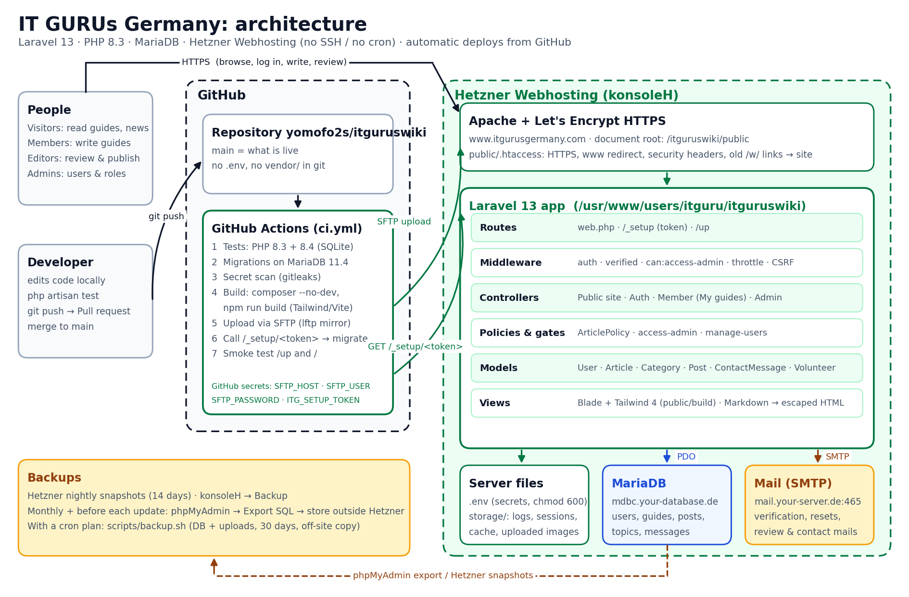

# IT GURUs Germany

Help make our life better with good news.

The community website for Nigerians and Africans living in, or moving to, Germany. It collects
verified, up-to-date guides on studying, work, visas, family reunion and everyday life, plus
news, events and a volunteer programme.

- Live: https://www.itgurusgermany.com
- Project board: https://github.com/users/yomofo2s/projects/3



## Features

| Area | What it does |
|---|---|
| **Guides** (knowledge base) | Topics, full-text search, Markdown articles with tables, cover images, official source links, reading time, view counts |
| **Editorial workflow** | Members write guides → *Submit for review* → editors **publish** or **request changes** (authors get an email) |
| **News & events** | News posts and events with date, location and registration link. Scheduling via a publish date |
| **Community** | Volunteer sign-up, social links, upcoming events, contact form (stored + emailed) |
| **Accounts** | Registration with email verification, login with rate limiting, password reset, profile, self-service account deletion |
| **Roles** | `member` writes guides · `editor` reviews/publishes, manages news, topics, inbox · `admin` also manages roles |
| **Admin area** | `/admin`: review queue, guides, news & events, topics, messages, volunteers, users & roles |
| **Security** | Escaped Markdown (no HTML/JS injection), CSRF, honeypots and throttling on public forms, policies on every action, HTTPS + security headers |

## Tech stack

- **Laravel 13** (PHP 8.3+), Blade, Tailwind CSS 4 (built with Vite), self-hosted Inter font (no Google calls, GDPR-friendly)
- **MariaDB** in production (Hetzner Webhosting). SQLite for local development and tests
- Hosting plan without SSH or cron: mail is sent immediately (`QUEUE_CONNECTION=sync`), sessions and cache are stored in files,
  and database migrations run through a token-protected setup link (`/_setup/<token>`)

## Deployment

**Every merge to `main` deploys automatically** (`.github/workflows/ci.yml`):

1. Tests on PHP 8.3 and 8.4, migrations on MariaDB, secret scan
2. Production build: `composer install --no-dev` + `npm run build`
3. SFTP upload to Hetzner. `.env`, uploads, logs and sessions on the server are never touched
4. `/_setup/<token>` runs new migrations, then a smoke test of `/up` and `/`

The deploy job runs in the GitHub **`production` environment**, limited to `main`, and waits for a required reviewer to approve.
Its secrets live under Settings → Environments → production → *Environment secrets*:

| Secret | Value |
|---|---|
| `SFTP_HOST` | Bare hostname only (no `sftp://`, port or spaces) |
| `SFTP_USER`, `SFTP_PASSWORD` | SFTP login for the Hetzner account |
| `ITG_SETUP_TOKEN` | At least 32 characters. Must match `ITG_SETUP_TOKEN` in the server `.env` |

Do not also keep these as repository secrets: any collaborator with write access can read those from a branch workflow.
Optional repository variables: `DEPLOY_ENABLED=false` pauses deploys, `SFTP_REMOTE_DIR` (default `itguruswiki`), `SITE_URL`.
The daily `health-check` workflow reads the same environment secrets.
Full runbook, first-time setup and backups: [docs/HOSTING.md](docs/HOSTING.md).

### Test deployment

Before merging, the maintainer deploys the branch to the **test site**: GitHub → Actions → **test-deploy** → Run workflow → enter the branch name.
It builds the branch, uploads it to the test site, runs migrations and a smoke test. It never touches the live site.
It runs in the `staging` environment, which needs its own settings (Settings → Environments → staging, maintainer as required reviewer):

| Name | Kind | Value |
|---|---|---|
| `SFTP_HOST`, `SFTP_USER`, `SFTP_PASSWORD` | secret | SFTP login that can only reach the test site's folder |
| `ITG_SETUP_TOKEN` | secret | At least 32 characters, same as in the test site's `.env` |
| `SFTP_REMOTE_DIR` | variable | The test site's app folder on the server (not the live `itguruswiki`) |
| `SITE_URL` | variable | The test site's URL (not `www.itgurusgermany.com`) |

The test site needs its own folder, its own `.env` and its own database. Never point it at the live database.

## Local development

Requirements: PHP 8.3+, Composer, Node 20+.

```bash
git clone git@github.com:yomofo2s/itguruswiki.git && cd itguruswiki
composer install
cp .env.example .env && php artisan key:generate
touch database/database.sqlite
php artisan migrate --seed
php artisan db:seed --class=DemoSeeder   # optional sample content
npm install && npm run build            # or: npm run dev (hot reload)
php artisan serve                       # http://localhost:8000
```

Demo logins (DemoSeeder): `admin@example.com` / `editor@example.com`, password `password`.
Create a real admin with `php artisan app:create-admin you@example.com`.

Optional: `docker compose up -d` starts MariaDB and Mailpit (see `compose.yaml`).

Run the tests: `php artisan test`.

## Project layout

| Path | Purpose |
|---|---|
| `app/Models`, `app/Enums` | Article, Category, Post, User (+ Role), ContactMessage, Volunteer |
| `app/Http/Controllers` | Public site, `Auth/`, member area (`MyArticleController`), `Admin/` |
| `app/Policies/ArticlePolicy.php` | Who may view, edit, delete and moderate guides |
| `resources/views` | Blade templates. `components/layouts` has the app, auth and admin layouts |
| `database/seeders` | `CategorySeeder` (production topics), `DemoSeeder` (local sample data) |
| `routes/web.php`, `routes/console.php` | Routes, `app:create-admin`, scheduler |
| `app/Http/Controllers/SetupController.php` | Token-protected `/_setup` link: migrations and first admin (no SSH needed) |
| `.github/workflows/ci.yml` | Tests, build, automatic SFTP deploy |
| `.github/workflows/health-check.yml` | Checks the live site: pages, mail (SMTP test), error log. Manual + daily |
| `scripts/` | `deploy.sh`, `post-deploy.sh` (SSH plans), `backup.sh` (cron plans) |
| `docs/HOSTING.md` | **Production runbook for Hetzner** |
| `docs/architecture.png` | Architecture diagram |

## Contributing

Contributors work on branches in this repository. Nobody pushes to `main` directly. The maintainer approves every
change, runs a test deployment, and then merges it into `main`. CI (tests on PHP 8.3/8.4, MariaDB migrations,
secret scan) must be green first. Merging into `main` deploys to the live site after the `production` reviewer approves.

### Step by step

1. **Get access.** Ask the maintainer to add you as a collaborator, then accept the invitation by email.
2. **Clone the repository** over HTTPS (no SSH key needed). Sign in with your GitHub account or a personal access token when asked:
   ```bash
   git clone https://github.com/yomofo2s/itguruswiki.git && cd itguruswiki
   ```
3. **Set up locally** (see [Local development](#local-development)):
   ```bash
   composer install && npm install && npm run build
   cp .env.example .env && php artisan key:generate
   touch database/database.sqlite && php artisan migrate --seed
   ```
4. **Pick a task** on the [project board](https://github.com/users/yomofo2s/projects/3) and tell the others you are working on it.
5. **Create a branch from an up-to-date `main`.** Use `feature/…`, `fix/…` or `docs/…`:
   ```bash
   git checkout main && git pull
   git checkout -b feature/my-change
   ```
6. **Make your change.** Keep it small and focused. Use `npm run dev` for hot reload while working on views.
7. **Test it.** Run `php artisan test`, check the pages in the browser, and add or update tests for new behaviour.
8. **Commit** with a message that says what changed and why:
   ```bash
   git add <files>
   git commit -m "Add event registration link to event cards"
   ```
9. **Push your branch:**
   ```bash
   git push --set-upstream origin feature/my-change
   ```
10. **Open a pull request into `main`.** Describe the change, link the board item and add screenshots for visible changes.
11. **Wait for CI and review.** Fix failures and review comments by committing to the same branch and pushing again.
12. **The maintainer approves, runs the test deployment and merges.** The maintainer starts Actions → *test-deploy* with your branch name, checks the result on the test site, then merges. You do not merge or deploy yourself.
13. **Clean up** after the merge:
    ```bash
    git checkout main && git pull && git branch -d feature/my-change
    ```

### Rules

- Never commit `.env`, passwords, API keys, tokens or database dumps. The secret scan fails the PR if it finds one.
- Do not edit `.github/workflows/` without asking the maintainer.
- Deploy secrets live only in the GitHub `production` environment. Contributors never need them.
- If a secret is committed by mistake, tell the maintainer right away so it can be rotated.

See also the [code of conduct](CODE_OF_CONDUCT.md). Licensed under GPL-3.0.
